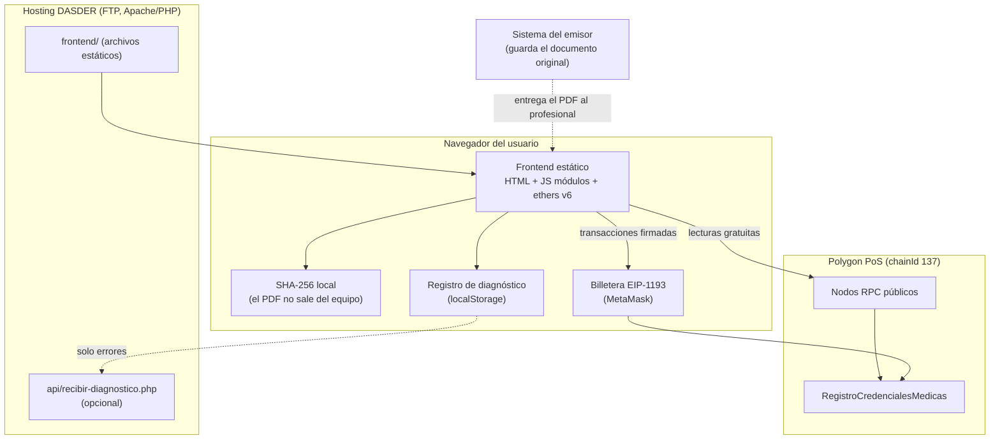
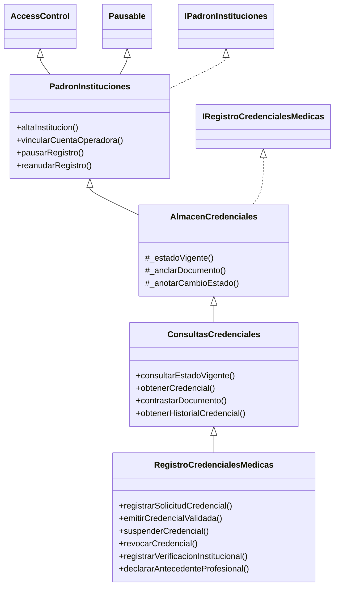
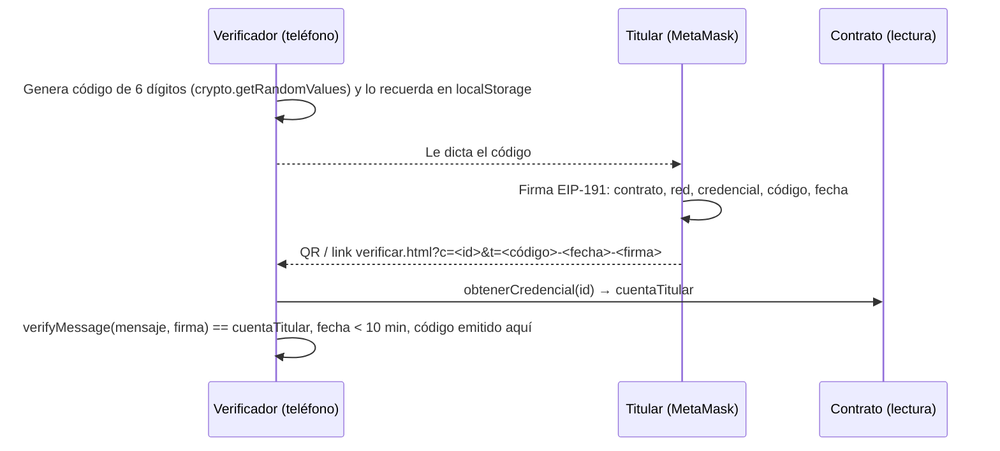

# Arquitectura

## 1. Vista general



No hay backend propio ni base de datos: la blockchain es la única fuente de verdad y el sitio es estático. Por eso se sube por FTP sin requisitos de servidor (PHP solo hace falta para el colector opcional de errores).

## 2. Contrato

### Herencia (un archivo por responsabilidad)



| Archivo | Responsabilidad |
|---|---|
| `tipos/TiposCredencialMedica.sol` | Enums y structs. El frontend replica el orden de los enums en `formato-credencial.js`. |
| `errores/ErroresRegistroCredenciales.sol` | Errores tipados. El frontend los traduce a mensajes en `errores-contrato.js`. |
| `interfaces/` | Eventos y firmas públicas. |
| `base/PadronInstituciones.sol` | Gobernanza, padrón y pausa. |
| `base/AlmacenCredenciales.sol` | Almacenamiento y reglas internas: estado vigente, anclaje, historial, autorización. |
| `base/ConsultasCredenciales.sol` | Consultas `view`, gratuitas. |
| `RegistroCredencialesMedicas.sol` | Operaciones del DTE. |

### Decisiones de diseño

| Decisión | Alternativa descartada | Motivo |
|---|---|---|
| Registro por identificador (`bytes32` aleatorio) | NFT ERC-721 | Una credencial no se transfiere. El SBT queda para una fase 2. |
| Instituciones con cuentas operadoras | Rol por persona | Las autoridades cambian: las credenciales quedan asociadas a la institución, no a una persona física. Es la idea de "DAO institucional" de la clase 14. |
| Historial **en storage** además de eventos | Solo eventos más un indexador | Los RPC públicos limitan `eth_getLogs`. Con el historial en storage, una sola llamada `view` alcanza y no hace falta The Graph ni un backend. Cuesta más gas, que en Polygon es barato. |
| Vencimiento calculado en cada consulta | Tarea programada que vence credenciales | No depende de nadie que ejecute la transacción: el estado vigente siempre es correcto. |
| SHA-256 del documento | keccak256 | Es estándar y se puede verificar fuera de la blockchain con `shasum -a 256`. |
| Errores tipados (custom errors) | `require` con texto | Ahorran gas y el frontend los decodifica por nombre. |
| Sin contrato actualizable (proxy) | UUPS / Transparent | Simplicidad y auditabilidad para el MVP. Queda registrado como deuda técnica. |

### Costos de gas medidos (`forge test --gas-report`)

| Operación | Gas (mediana) |
|---|---|
| `registrarSolicitudCredencial` | ~239.000 |
| `validarSolicitudCredencial` | ~91.000 |
| `emitirCredencialValidada` | ~139.000 |
| Ciclo completo solicitud + validación + emisión | ~469.000 |
| `suspenderCredencial` / `revocarCredencial` | ~111.000 |
| `registrarVerificacionInstitucional` | ~84.000 |
| `declararAntecedenteProfesional` | ~105.000 |
| Carga inicial (lote de 2) | ~457.000 (~230.000 por credencial) |

## 3. Frontend

```
frontend/
  *.html                       una página por rol: inicio, verificar, emisor, titular, verificador, gobernanza, privacidad
  config/config.js             ÚNICO archivo que cambia por entorno (red, contrato, URL base, equipo)
  assets/css/                  variables (tokens) · base · layout · componentes/*
  assets/js/nucleo/            configuración, red, contrato, errores, huellas, formato, DOM seguro, diagnóstico
  assets/js/componentes/       cabecera, avisos, billetera, estado, QR, historial, selector de documento, pestañas
  assets/js/paginas/           un módulo por página (+ emisor/ dividido por tarea)
  assets/vendor/               ethers 6.17.0 y qrcode-generator 2.0.4 (sin CDN)
  assets/fuentes/              Lora y Source Sans 3 (alojadas localmente)
  api/                         colector PHP de diagnóstico (opcional)
```

- **Sin build ni framework:** ES modules nativos. Se edita y se sube por FTP.
- **Sin dependencias externas en tiempo de ejecución:** librerías y fuentes alojadas en el propio sitio, para no exponer la IP del visitante a CDNs de terceros.
- **Lectura sin billetera:** el primer RPC de `config.red.rpcLectura` que responde se usa como proveedor (`red-blockchain.js`).
- **Escritura:** `ejecutarTransaccionRegistro` estima el gas antes de abrir la billetera. Así detecta el error del contrato y muestra un mensaje claro en vez de un rechazo genérico.
- **Seguridad del DOM:** todo texto que viene de la cadena (nombres de instituciones, antecedentes) se inserta con `textContent` (`dom-seguro.js`). No se usa `innerHTML`.
- **Prueba de titularidad (sin gas, sin backend):** ver el diagrama de abajo. `nucleo/prueba-titularidad.js` arma el mensaje y valida la firma; `componentes/panel-prueba-titularidad.js` es el lado del verificador y `componentes/firma-titularidad.js` el del titular.
- **Accesibilidad:**
  - etiquetas asociadas a cada campo y foco visible;
  - controles de 44 px;
  - `aria-live` en los resultados;
  - diálogos nativos con foco atrapado;
  - el estado se comunica con color, texto e ícono.

### Prueba de titularidad



La firma no queda en la cadena ni la procesa ningún servidor: la comprueba el navegador del verificador. Viaja en el link (`?t=`), así que puede aparecer en el log de accesos del hosting; contiene la wallet del titular (ya pública en la credencial), el código y la fecha, sin datos personales. La vigencia se configura en `config.js` → `pruebaTitularidad.vigenciaSegundos`.

## 4. Registro de diagnóstico (logs)

| Capa | Qué registra | Dónde |
|---|---|---|
| Navegador | Conexión a RPC, billetera, cada transacción (preparada, enviada, confirmada o fallida con el error decodificado), huellas calculadas, errores no controlados | `localStorage` (últimas 500 entradas). Se ve y se descarga en JSON desde «Diagnóstico» en el pie. |
| Hosting (opcional) | Solo errores, con IP seudonimizada por día | `frontend/api/registros/diagnostico-AAAA-MM.log.php` (el guard PHP devuelve 404 si se pide por URL; se baja por FTP) |
| Blockchain | Todos los cambios de estado, con fecha, institución, operador y acto | Eventos e historial on-chain |
| Despliegue | Transacciones de cada script | `broadcast/` (Foundry) y `despliegues/<chainId>.json` |

## 5. Datos estructurales y transaccionales

| Naturaleza | Qué incluye | Cómo se carga |
|---|---|---|
| **Estructural** (configuración) | Instituciones del padrón, tipos que puede emitir cada una, cuentas operadoras, roles | Semilla versionada `config/padron-demo.json` + `script/SembrarPadronDemo.s.sol` |
| **Transaccional** (uso) | Credenciales, historial, verificaciones, antecedentes | Se genera al operar. Los datos de demo (`demo/` + `CargarCredencialesDemo.s.sol`) son transaccionales de muestra. |
| Configuración del sitio | Red, dirección del contrato, URL base | `frontend/config/config.js` |

Regla: si hace falta cargarlo para levantar el sistema en una red nueva, es estructural y va en la semilla. En blockchain no hay "reseteo": un entorno limpio se obtiene desplegando un contrato nuevo y corriendo la semilla.

## 6. Seguridad: amenazas y mitigaciones

| Amenaza | Mitigación |
|---|---|
| Una institución modifica credenciales de otra | `OperadorDeOtraInstitucion`: solo la institución emisora cambia el estado. |
| La gobernanza altera una credencial | El admin no tiene acceso a funciones de estado (lo cubre un test). |
| Se roba la clave de una institución | La gobernanza desvincula la cuenta o deshabilita la institución. Pausa global en caso de incidente. |
| Documento adulterado | La huella SHA-256 no coincide y el contraste lo marca. |
| Reutilizar un documento en otra credencial | `HashDocumentoYaAnclado`. |
| Inferir datos personales desde la cadena | Ids aleatorios y huellas de documentos completos, nunca de datos de baja entropía. |
| XSS con un nombre de institución malicioso | Render con `textContent`. CSP en `.htaccess`. |
| Alguien presenta el QR o el PDF de otro profesional | Prueba de titularidad: firma del código del verificador con la wallet vinculada. Sin wallet vinculada, DNI. |
| Reusar una prueba de titularidad vieja | El mensaje firmado incluye contrato, red, credencial, código y fecha; vence a los 10 minutos y el código se compara con los generados en ese dispositivo. |
| Spam de antecedentes | Solo el titular, máximo 50 por credencial y 140 bytes cada uno. |
| Manipulación de `block.timestamp` por validadores | Tolerancia de segundos irrelevante para vencimientos expresados en días (advertencia del linter aceptada). |
