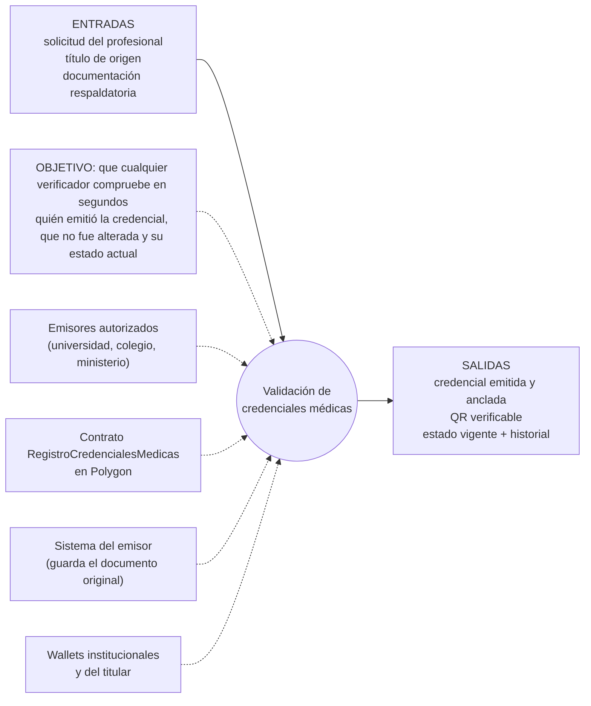
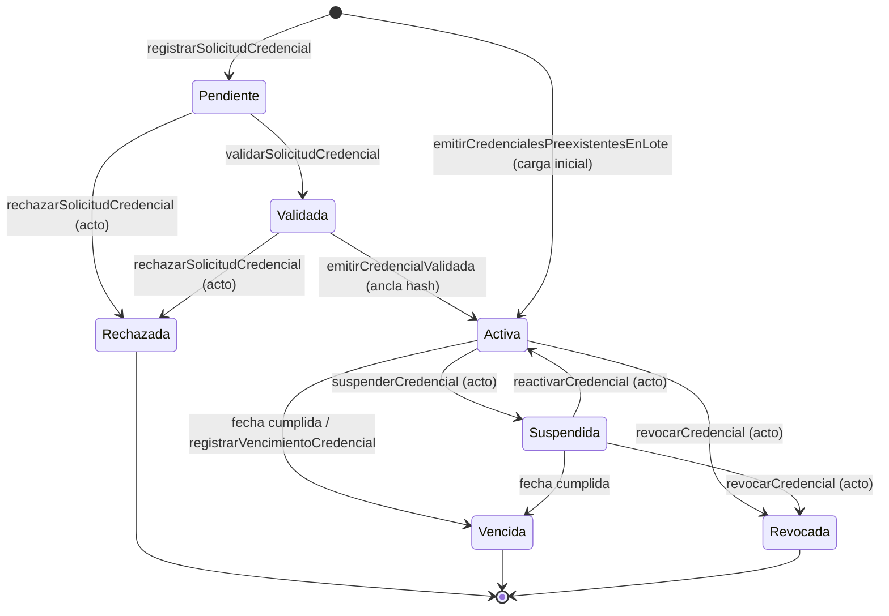

# Modelado del contrato inteligente

Entregable 5 del DIG. Aplica la metodología del Módulo 4: proceso de negocio, caso de uso, espina de pescado, DTE y patrones de eventos. Parte de la propuesta presentada por el Grupo 1 y de las devoluciones del Mini Demo Day (clase 15).

## 1. Proceso de negocio

**Validación de credenciales médicas.** Hoy los títulos, matrículas y especialidades están repartidos entre universidades, colegios profesionales, ministerios e instituciones de salud. Cada provincia tiene su propio colegio: una suspensión de matrícula en una jurisdicción no aparece en otra. El sistema suma una capa de confianza sobre esos registros y no los reemplaza. Según la devolución de Oscar, funciona como un "troyano" de la tecnología que se inserta en el flujo de validaciones que ya existe.

**Alcance del MVP.** Siguiendo a Oscar y Euge, el MVP se centra en la matrícula y la credencial colegial. Receta electrónica y prestaciones quedan fuera.

### Espina de pescado (Eriksson–Penker)

| Elemento | Contenido |
|---|---|
| Objetivo (una oración) | Que cualquier verificador compruebe en segundos quién emitió la credencial, que no fue alterada y su estado actual. |
| Entradas | Solicitud del profesional, título de origen, documentación respaldatoria. |
| Salidas | Credencial emitida con la huella anclada, QR verificable, estado vigente e historial. |
| Recursos | Emisores autorizados, contrato en Polygon, sistema del emisor (off-chain), wallets institucionales y del titular. |

## 2. Caso de uso blockchain

- **Principal: identidad digital.** Asocia una credencial profesional verificable a un sujeto y a la institución que la emitió, de forma comprobable criptográficamente.
- **Relacionados:**
  - Certificación digital: anclaje de la huella del documento.
  - Verificación documental: comprobación pública de la huella y del estado.
  - Trazabilidad: historial inmutable de emisión, suspensión y revocación.

### ¿Hace falta blockchain? (árbol de decisión, clase 40)

| Pregunta | Respuesta |
|---|---|
| ¿Se necesita una base de datos distribuida? | Sí. Hay registros en muchas jurisdicciones y ninguna es dueña de las demás. |
| ¿Hay varias personas jurídicas? | Sí: universidades, colegios provinciales, ministerios, prestadores. |
| ¿Hay conflicto de intereses o problemas de confiabilidad entre ellas? | Sí. No hay trazabilidad interprovincial y cada una depende de la API de la otra. |
| ¿Prefieren no depender de un tercero de confianza? | Sí. Ningún colegio quiere que otro colegio sea dueño del registro. |
| ¿Las reglas son constantes sin importar quién participa? | Sí. El ciclo de vida de una credencial es el mismo en todas las jurisdicciones. |

**Frente a una base centralizada** (la pregunta de Pacho): ya existe un registro nacional de profesionales de la salud. Lo que agrega blockchain es:

- verificar sin llamar a la API del emisor;
- probar que el documento no fue alterado;
- un historial que ninguna institución puede reescribir;
- la constancia de quién verificó y cuándo.

## 3. Activo representado

**La credencial**, como activo lógico **no transferible**. No se modela como NFT ERC-721. Siguiendo el planteo de Fer en la clase 35: si el título se puede vender, deja de decir algo de su dueño. La evolución natural es un SBT (ERC-5192), que figura como mejora futura.

### Atributos on-chain (`struct Credencial`)

| Atributo | Tipo | Descripción |
|---|---|---|
| `hashDocumento` | bytes32 | SHA-256 del PDF emitido. Se puede recalcular con `shasum -a 256`. |
| `referenciaInterna` | bytes32 | Huella de la referencia interna del emisor (expediente o legajo). |
| `cuentaTitular` | address | Wallet del profesional (opcional). |
| `solicitadaEl`, `emitidaEl`, `venceEl`, `actualizadaEl` | uint64 | Marcas de tiempo. Si `venceEl` es 0, la credencial no vence. |
| `institucionEmisora` | uint32 | Institución del padrón que la emitió. |
| `tipo` | enum | Título profesional, credencial colegial, matrícula sanitaria o certificado de especialidad. |
| `estado` | enum | Estado persistido. El vigente puede diferir por fecha. |
| `cargaInicial` | bool | Indica si se emitió antes de sumarse al registro. |

El identificador de la credencial es aleatorio: 32 bytes generados en el navegador del emisor. **No deriva de ningún dato personal.**

## 4. Actores

| Actor | Rol on-chain | Acciones en el DTE |
|---|---|---|
| Universidad / Colegio / Ministerio | Cuenta operadora de una institución **emisora** | Solicitar, validar, rechazar, emitir, suspender, reactivar, revocar, vincular wallet del titular, carga inicial |
| Profesional (titular) | `cuentaTitular` de su credencial | Presentar el QR, probar su titularidad firmando el código de un verificador (off-chain, EIP-191), declarar y retirar antecedentes propios |
| Hospital, clínica u otro colegio | Cuenta operadora de una institución del padrón | Registrar la verificación institucional (quién y cuándo) |
| Público (pacientes, auditores) | Ninguno (lectura) | Verificar por QR, identificador o PDF, sin costo |
| Gobernanza (Safe multisig en producción) | `DEFAULT_ADMIN_ROLE` | Alta y habilitación de instituciones, vínculo de cuentas, reanudar el registro |
| Guardián | `ROL_GUARDIAN_PAUSA` | Pausa de emergencia |

**Separación de poderes:** la gobernanza **no puede** cambiar el estado de ninguna credencial. El contrato lo garantiza y hay un test que lo prueba (`test_GobernanzaNoPuedeCambiarEstados`).

## 5. DTE implementado

Verificar (QR, identificador o PDF) es una consulta y **no cambia el estado**. La verificación institucional sí deja una constancia, pero tampoco cambia el estado.

### Diferencias con el DTE presentado y por qué

| Agregado | Motivo |
|---|---|
| Estado **Rechazada** desde Pendiente/Validada | Camino de excepción: la validación puede fallar. Oscar en la clase 15: "el proceso de negocio falla por no darle bolilla a las excepciones". |
| **Suspendida → Revocada** | Una credencial suspendida por sanción puede terminar revocada. Si no existiera esta flecha, habría que reactivarla primero. |
| **Suspendida → Vencida** | Sin esta flecha, una credencial que vence mientras está suspendida quedaría trabada para siempre. |
| **Vencimiento automático por fecha** | Para que esté Vencida no hace falta una transacción. El estado vigente se calcula en cada consulta y cualquiera puede dejar asentado el vencimiento en el historial. |
| **Carga inicial** | Los colegios ya tienen miles de matrículas emitidas. Se migran en lotes de hasta 50, marcadas como `cargaInicial`. |
| **Acto administrativo obligatorio** | Suspender, reactivar, revocar y rechazar exigen la huella del acto (resolución o dictamen) que lo respalda. |

### Tabla de transiciones

| Desde | Evento (función) | Quién | Guarda | Hacia | Qué queda on-chain |
|---|---|---|---|---|---|
| — | `registrarSolicitudCredencial` | Emisor | Institución habilitada y tipo permitido; id nuevo | Pendiente | id, tipo, institución, fecha, ref. interna |
| Pendiente | `validarSolicitudCredencial` | Emisor de origen | — | Validada | fecha, operador |
| Pendiente / Validada | `rechazarSolicitudCredencial` | Emisor de origen | Acto ≠ 0 | Rechazada | huella del acto |
| Validada | `emitirCredencialValidada` | Emisor de origen | Hash ≠ 0 y no usado; vencimiento futuro | Activa | huella del documento, vencimiento |
| — | `emitirCredencialesPreexistentesEnLote` | Emisor | 1 a 50 ítems; emisión ≤ hoy | Activa | ídem, más `cargaInicial` |
| Activa | `suspenderCredencial` | Emisor de origen | Acto ≠ 0 | Suspendida | huella del acto |
| Suspendida | `reactivarCredencial` | Emisor de origen | Acto ≠ 0; no vencida | Activa | huella del acto |
| Activa / Suspendida | `revocarCredencial` | Emisor de origen | Acto ≠ 0 | Revocada | huella del acto |
| Activa / Suspendida | `registrarVencimientoCredencial` | Cualquiera | `venceEl` cumplido | Vencida | fecha |
| (cualquiera) | `registrarVerificacionInstitucional` | Institución del padrón | Credencial existente | (sin cambio) | institución verificadora, fecha, estado observado |
| Activa | `declararAntecedenteProfesional` | Titular | Descripción de 1 a 140 bytes; máximo 50 | (sin cambio) | huella de la evidencia, descripción |

## 6. Patrones de eventos (EPCIS / GS1)

| Evento del dominio | Patrón EPCIS | Operación |
|---|---|---|
| Solicitud, carga inicial | Orden de trabajo | CREATE |
| Validación, emisión (anclaje), suspensión, reactivación | Observación | OBSERVE |
| Verificación institucional | Observación (sin cambio de estado) | LOG |
| Vencimiento, revocación, rechazo | Desmantelamiento lógico (sale de vigencia; el registro permanece) | DELETE lógico |

Cada evento emite `CambioEstadoCredencial(idCredencial, idInstitucion, accion, estadoAnterior, estadoNuevo, referenciaActo, operador)`. Además, se guarda en el historial on-chain de la credencial para poder consultarlo sin un indexador.

## 7. Qué va y qué no va a la cadena

| On-chain | Off-chain (sistema del emisor) |
|---|---|
| Huella del documento, huella del acto | El PDF de la credencial y de los actos |
| Estado, fechas, institución, operador | Nombre, DNI, domicilio y demás datos personales |
| Constancias de verificación institucional | Información clínica: **nunca** |
| Antecedentes autodeclarados (texto que decide el titular) | Evidencias de los antecedentes (solo su huella) |

**Por qué hashear el documento completo y no el DNI o la matrícula:** un dato con pocas combinaciones posibles se puede revertir probándolas todas (ataque de diccionario). El PDF completo no.

## 8. One-pager del modelado

| | |
|---|---|
| **Proceso** | Validación de credenciales médicas |
| **Caso de uso** | Identidad digital (+ certificación, verificación documental, trazabilidad) |
| **Activo** | Credencial (lógica, no transferible) |
| **Red** | Polygon PoS, red principal (chainId 137). Red pública EVM con costo bajo por evento. Contrato `0x374adD49ce1101BC440b431EC24eee36a6A98565`. |
| **Contrato** | `RegistroCredencialesMedicas`, en Solidity 0.8.30 con OpenZeppelin 5.7 (AccessControl, Pausable) |
| **Estados** | Pendiente, Validada, Activa, Suspendida, Vencida, Revocada, Rechazada |
| **Actores** | Emisores, titular, verificadores, gobernanza, guardián |
| **Garantías** | Emisión por entidad autorizada · integridad del documento · estado vigente consultable · historial inmutable · quién verificó |
| **Privacidad** | Sin datos personales on-chain; ids aleatorios; huellas de documentos completos |
| **Pruebas** | 49 tests (unitarios, excepciones y fuzzing): 100 % de líneas, 92,9 % de ramas |
